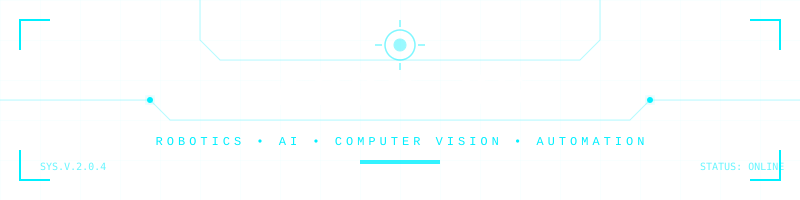
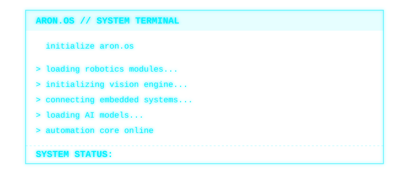
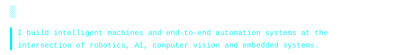
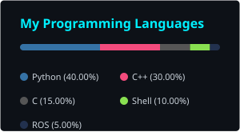

<div align="center">



[](https://git.io/typing-svg)

</div>

<br>

<div align="center">

</div>

<div align="center">
  
</div>

<div align="center">
  
  <br><br>
  
</div>

<div align="center">

| CATEGORY | TECHNOLOGIES |
|:---|:---|
| **LANGUAGES** |  |
| **AI / ML** |  |
| **ROBOTICS** |  |
| **SOFTWARE** |  |
| **DESIGN** |  |

*Note: Some custom robotics/AI icons are represented by their broader categories or text tags above to maintain visual consistency.*
</div>

<div align="center">
  
  <br><br>
  
</div>

<div align="center">
  
  
  
  <br><br>
  
  
</div>

<div align="center">
  
  <br><br>
  
</div>

<div align="center">
  
  <br><br>
  
</div>

<div align="center">
  
  <br><br>
  
</div>

<table>
<tr>
<td width="50%">

#### `01 / ROBOTICS`
- Industrial robotic arms
- 6-axis automation
- Autonomous robots
- Robotic workflows
- Human-robot interaction
- Digital twins

</td>
<td width="50%">

#### `02 / AI & COMPUTER VISION`
- Object detection
- Computer vision
- Pose estimation
- Edge AI
- Machine learning
- Generative AI

</td>
</tr>
<tr>
<td>

#### `03 / EMBEDDED & IoT`
- ESP32
- Arduino
- Raspberry Pi
- Jetson
- Sensors
- Actuators
- IoT

</td>
<td>

#### `04 / SOFTWARE`
- Python
- C++
- OpenCV
- ROS / ROS2
- FastAPI
- Flask
- Git
- CI/CD

</td>
</tr>
</table>

<div align="center">
  
  <br><br>
  
</div>

```yaml
MISSION_STATUS: ACTIVE

CURRENTLY_EXPLORING:
  → Advanced Robotics Systems
  → Edge AI
  → Intelligent Automation
  → Computer Vision
  → Human-Robot Interaction
  → AI-powered robotic systems

BUILDING:
  → Autonomous machines
  → Vision-based automation
  → Scalable embedded platforms
  → Intelligent robotic workflows
